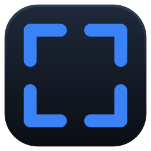

# Snipline

A Windows screenshot tool with a real annotation editor. Global hotkey → region select across
any monitor → draw arrows, boxes, text, step badges, and redaction → clipboard or file.

Built to be correct on the setups most hobby screenshot tools break on: **multi-monitor at mixed
DPI** (a 4K 150% panel next to a 1080p 100% panel), negative-coordinate monitor layouts, and
per-monitor scaling changes while the app is running.

> **Status:** v1 complete. All six milestones shipped, 448 tests green, and the packaged
> `Snipline.exe` builds and runs. See [`docs/PLAN.md`](docs/PLAN.md) for the milestone-by-milestone
> build order and [`docs/ARCHITECTURE.md`](docs/ARCHITECTURE.md) for the layer design.
>
> Multi-monitor mixed-DPI *timing* is still unmeasured — see the caveat under
> [Measured numbers](#measured-numbers).

---

## Why this exists

Screenshot tools are a solved problem in the sense that many exist, and an unsolved problem in the
sense that most of them get multi-monitor DPI wrong. This project takes the position that the
interesting engineering is not the drawing tools — it's the coordinate math at the OS boundary,
and proving it works with numbers rather than screenshots of screenshots.

## Measured numbers

Measured on a **single 1920×1080 display at 125% scaling** (Windows 10 build 26200, Python 3.11,
PySide6 6.11.1), 40 samples per span after 3 warm-up runs, machine otherwise idle. Reproduce with
`python -m snipline.tools.benchmark`.

| Span | Target (p95) | Measured p50 | Measured p95 |
|---|---|---|---|
| hotkey press → overlay visible | < 120 ms | 34.8 ms | **43.9 ms** |
| region release → editor ready | < 80 ms | 14.7 ms | **23.3 ms** |
| export → clipboard populated | < 60 ms | 3.1 ms | **7.0 ms** |
| monitors handled at mixed DPI | 3 @ 100/125/150% | _not measured_ | _not measured_ |

The first row is the one users feel. Everything else is comfort.

**The last row is not measured, and that matters.** The development machine has one display, so
these timings come from the easiest possible configuration. The multi-monitor mixed-DPI geometry
is covered by unit tests against synthetic layouts including negative-origin monitors — what is
missing is *timing* on real multi-monitor hardware, not correctness coverage. See
[`docs/BENCHMARKS.md`](docs/BENCHMARKS.md) for the full table and the caveats behind it.

## Features

- Global hotkey capture that works while another application has focus
- Frozen-frame region selection overlay with a nearest-neighbour magnifier loupe, showing pixel
  coordinates and the colour under the pointer
- Vector annotation editor with full undo/redo: arrow, rectangle, ellipse, freehand, text,
  numbered step badges
- Redaction: pixelate and solid fill (see the security note below)
- Export to clipboard or file (PNG, WebP, JPEG)
- System tray, single-instance enforcement, configurable hotkey
- Dark chrome throughout, with every icon drawn from geometry rather than shipped as a file (D12,
  D13)

## Using it

Run `Snipline.exe` (or `snipline` from a dev install). It starts in the system tray with no window —
that is intentional, a screenshot tool that steals focus at launch is a screenshot tool you cannot
use to capture the thing you were looking at.

| Action | Key |
|---|---|
| Start a capture | **Ctrl+Shift+S** (configurable in tray → Settings) |
| Cancel the overlay, or close the editor | `Esc` |
| Undo | `Ctrl+Z` |
| Redo | `Ctrl+Y` or `Ctrl+Shift+Z` |

Capture → drag a region → annotate → copy to clipboard or save to file. A second launch is refused
by the single-instance lock and exits silently rather than fighting the first one for the hotkey.

## Redaction is not blur

Snipline ships **pixelate** and **solid fill** as its redaction tools, and solid fill is the
default. Gaussian blur is offered only as a cosmetic effect and is labelled as such in the UI.

Blurred text is frequently recoverable. An attacker who knows the font, size, and blur radius can
render candidate strings, apply the same blur, and compare — which has exposed real credentials,
account numbers, and personal data in published screenshots. Any tool that presents blur as a
privacy feature is making a promise it cannot keep.

Snipline also flattens all annotations into the output image on export. There is no layered project
format in v1, deliberately: a layered file would still contain the original unredacted pixels
underneath the redaction, so sharing it would leak exactly the data the user tried to hide.

## Stack

Python 3.11+ · PySide6 (Qt 6, LGPL) · mss · Pillow · NumPy · ctypes for Win32

Rationale for each choice, including the ones rejected, is recorded in
[`docs/DECISIONS.md`](docs/DECISIONS.md).

## Development

```bash
python -m venv .venv
.venv\Scripts\activate
pip install -r requirements.txt -r requirements-dev.txt
pip install -e .    # also generates the snipline-* console scripts below

pytest              # headless, no real screen capture
pyright             # type gate
ruff check .        # lint
```

Tests never touch the real screen. Capture is behind a `CaptureBackend` protocol with a
`FakeBackend` implementation, so the geometry, DPI, undo, and export logic is fully testable in CI
with `QT_QPA_PLATFORM=offscreen`.

## Platform support

Windows 10/11 only in v1. The Win32-specific code is confined to `src/snipline/platform/`, which
is the seam a future macOS or Linux port would implement — but no such port is planned or promised.

## Licence

MIT. See [LICENSE](LICENSE).

PySide6 is LGPL and is used as a dynamically linked dependency, which is what keeps this project
free to relicence or ship as a binary. Do not swap it for PyQt6 without reading
[`docs/DECISIONS.md`](docs/DECISIONS.md) first.

## Building

```sh
pip install -r requirements.txt -r requirements-dev.txt
pip install -e .
pyinstaller snipline.spec
```

Produces `dist/Snipline/Snipline.exe` (~159 MB unpacked). The build is `--onedir` on purpose:
`--onefile` unpacks to a temp directory on every launch, which adds seconds of startup to a tool
whose whole point is responding instantly (D10). UPX compression is off because packed binaries
are a routine false positive for endpoint protection.

The executable's icon comes from `assets/snipline.ico`, which is committed so a fresh clone can
build without a Qt display first. It is a build-time input only — PyInstaller embeds it into the
exe's resource table and the running application never opens it, which is what keeps a real icon
file from reintroducing the missing-resource failure that every runtime glyph is drawn in code to
avoid (D13). Regenerate it after changing the mark:

```sh
python -m snipline.tools.make_icons
```

Command-line tools, useful for diagnosing capture geometry without any UI in the way:

```sh
snipline-grab --list                 # monitor layout in physical pixels
snipline-grab --all -o desktop.png   # whole virtual desktop
snipline-benchmark --runs 40         # the latency table above
```
